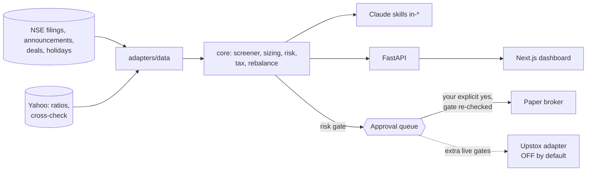

# india-trader

**Risk-gated research and paper-trading toolkit for Indian equities (NSE): Claude skills, a FastAPI backend and a Next.js dashboard, built on exchange filings instead of guesswork.**

   
[](https://github.com/amitshq/Indian-Trader-Skill/actions/workflows/ci.yml)

## About

`india-trader` helps one person research Indian stocks and practise delivery trades safely. It reads NSE's own filings (results, announcements, shareholding patterns, bulk/block deals, FII/DII flows, the official holiday list), screens and sizes ideas in whole shares, checks every order against limits you set, and only then puts it in front of you for an explicit yes. Everything runs in **paper mode** unless you deliberately turn live trading on, and a live Upstox adapter exists but has **never been run against the real API**.

Adapted from [trader-skill](https://github.com/Jakeschincariol/trader-skill) (MIT) and re-based on Indian rules: NSE/BSE, INR, T+1, whole shares, STCG/LTCG, April–March fiscal year.

> **Personal research tool. Not investment advice. Not SEBI-registered advice. Free data sources are unofficial and can be delayed, stale or wrong; every skill shows warnings instead of hiding them.**



## Test status

Run on a clean virtualenv installed with `pip install -e ".[dev,data]"` (Python 3.13, Windows), all offline: no network, no broker, no real money.

```text
118 passed in 5.54s
```

| Test file | Tests | Covers |
|---|---:|---|
| `test_core.py` | 9 | INR formatting, IST market clock, holidays, Muhurat day, order validation, charges, alert rules, Yahoo price-reading regression |
| `test_paper_api.py` | 4 | order queue, approval, risk-blocked orders, alerts |
| `test_phase2.py` | 8 | fiscal quarters, growth/margins/TTM, derived Q4, screener rules and ranking |
| `test_live_fundamentals.py` | 10 | Yahoo adapter, caching, stale cache, duplicate-row and overdue-results guards |
| `test_nse_results.py` | 12 | real NSE XBRL filing parse (consolidated and bank formats), retries, cross-check, stale-data flag |
| `test_results_pdf.py` | 12 | strict PDF table reader (fails closed), manual entry validation and merge |
| `test_phase3.py` | 9 | holidays, bulk/block deals, FII/DII, shareholding, insider rows, news tagging and de-duplication |
| `test_phase4.py` | 30 | sizing, risk gate, one-order approval parser, lots, STCG/LTCG, rebalance, broker integration |
| `test_api_planning.py` | 7 | sizing/rebalance/tax/market endpoints, order preview with every risk check, stock lookup, real-data screen, demo endpoint |
| `test_demo.py` | 8 | the dummy-money rehearsal: closed/old prices, NSE-vs-calendar disagreement, no quotes, skipped screen, hold-and-reprice |
| `test_upstox.py` | 9 | live gates, kill switch, caps, audit log (fake transport only) |

What the tests do **not** prove: behaviour against the real Upstox API, the accuracy of the unofficial NSE/Yahoo data on any given day, or the correctness of tax and charge rates (they are unverified estimates).
CI (`.github/workflows/ci.yml`) runs the same suite on Python 3.11 and 3.13 plus a TypeScript typecheck of the UI.

## What is in it

| Area | Skill / module | Data |
|---|---|---|
| Market clock | `core/calendar_in.py`, `config/holidays.json` | Real NSE 2026 holiday list (fetched from NSE), Muhurat day flagged as special session |
| Results | `skills/in-fundamentals`, `skills/in-screener` | NSE exchange XBRL filings (authority) cross-checked with Yahoo; manual/PDF entry for quarters the structured data lacks |
| News | `skills/in-news` | NSE announcements + Google News RSS, tagged, new-only |
| Deals & flows | `skills/in-deals` | NSE bulk/block deals (latest session), FII/DII flows |
| Ownership | `skills/in-insider` | Promoter holding from SEBI shareholding patterns; insider (PIT) disclosures (see limits) |
| Sizing | `skills/in-budget` | Whole-share BUY proposals from weights + budget |
| Risk gate | `skills/in-risk`, `core/risk.py` | Your own limits in `config/risk.json` |
| Approval | `skills/in-broker`, `core/approval.py` | Strict one-order "yes" parser |
| Tax | `skills/in-tax`, `core/tax.py` | Lots, STCG/LTCG estimate (delivery equity only) |
| Rebalance | `skills/in-rebalance` | Drift table + sells-first proposals with a cost check |
| Brokers | `adapters/broker/paper.py`, `adapters/broker/upstox.py` | Paper (default). Upstox live adapter: never run against the real API, disabled by default |

## The UI (four screens)

| Screen | What it is for |
|---|---|
| **Today** | Is the market open (our calendar vs what NSE itself says), your practice account, and a **Run the rehearsal** button that plays a whole trading day with dummy money and reports every step as OK / warning / failure |
| **Research** | Look up a stock (price with its age, latest results with every data warning, promoter holding, news), screen by rules (sample or real data), FII/DII flows and big deals |
| **Trade** | Build an order and see a live preview: the plain-English sentence, charges itemised, and *every* risk check ticked or crossed with its reason; approval queue; order history; budget sizing and rebalancing |
| **Portfolio & tax** | Holdings, tax lots, capital-gains estimate, "what if I sell?" |

Every screen explains its terms in "What does this mean?" panels and shows how old its data is.

## Rehearse a trading day with dummy money

```bash
python scripts/demo_session.py                      # now, ₹1,00,000 of dummy money, 6 large caps
python scripts/demo_session.py --hold-minutes 10    # buy, wait 10 minutes, re-price, sell half, show tax
python scripts/demo_session.py --wait-for-open      # sleep until 09:20 IST on the next trading day
```

It reads NSE's own market state, takes real (delayed) prices and shows how old each one is, runs the screen, sizes and queues orders through the risk gate, **simulates your approval** (labelled everywhere), fills, re-prices, sells half to exercise tax lots, then reads deals, flows, promoter holding and news. The report is saved to `data/reports/`. With the market closed it says plainly that it is working at last-close prices. It never touches a broker or your own practice account.

## Quick start

```bash
pip install -e ".[dev,data]"
python -m pytest -q                       # 118 tests, all offline
uvicorn api.main:app --reload             # http://localhost:8000/docs
cd ui && npm install && npm run dev       # http://localhost:3000
```

Without `QUOTES=yfinance` the API uses in-memory demo prices: set some with
`curl -X PUT localhost:8000/api/dev/quotes -H "Content-Type: application/json" -d '{"TCS":4000,"ITC":400}'`.
All environment variables are listed in [`.env.example`](.env.example).

Try the skills from a terminal:

```bash
python skills/in-screener/screen.py --symbols TCS INFY --rules config/rules.live.example.json
python skills/in-budget/size.py --budget 500000 --weights '{"TCS":40,"ITC":30,"INFY":30}' --max-position 45 --prices prices.json
python skills/in-deals/deals.py flows
python skills/in-insider/insider.py promoter TCS ITC
```

To use them as Claude Code skills, copy the `skills/in-*` folders into `~/.claude/skills/` or `<project>/.claude/skills/`; each has a `SKILL.md` telling Claude what it may and may not claim.

## Safety model (the part to understand)

1. Nothing is sent anywhere on submit. Orders go: risk gate -> `PENDING` (or `BLOCKED`) -> **you approve each order** -> risk gate is re-checked at that moment -> fill (paper) or send (live).
2. `BLOCKED` orders can never be approved. Chat approvals go through `parse_yes`: "sure", "yes to all", a wrong stock/side/quantity are refused.
3. Live orders additionally need: `config/live.json` `live_enabled: true`, env `INDIA_TRADER_LIVE=I_UNDERSTAND_THIS_USES_REAL_MONEY`, no kill-switch file, order value under a small cap (default ₹10,000), a daily live order cap, and the risk gate re-run against the broker's real funds/holdings. Every attempt is written to `data/live_audit.jsonl`. Secrets come from env vars only and are never stored.
4. The UI banner shows PAPER or LIVE straight from the backend.

## Data you must know about

- **Results**: NSE's structured results dataset lagged badly for the symbols tested (Dec 2024 at Oct 2026) while its announcements feed showed newer filings. Stale stocks are flagged OUT OF DATE (with the PDF link) and fail the live rules. Fill gaps with `skills/in-fundamentals/add_result.py` (you or Claude read the PDF; entries are validated and always carry a review warning). The automatic PDF reader fails closed and rejected the three real PDFs it was tried on (scans, shifted columns, cover letters).
- **Yahoo** supplies ROCE/ROE/debt-equity; no promoter pledge anywhere. Banks need different rules than industrials.
- **Insider (PIT)** returned no rows for the windows tried; treat empty as unconfirmed.
- **Bulk/block deals**: latest session only.
- `config/charges.json` and `config/tax.json` are unverified estimates from memory: check them against your broker's charge sheet and a CA.

## Live trading with Upstox (read before enabling)

The adapter is written from Upstox's documentation and tested only against a fake transport. Before using it: read Upstox's current API docs and SEBI's retail-algo requirements (static IP whitelisting for API orders was being enforced in 2026), then try one tiny order on your own account. Set `UPSTOX_API_KEY`, `UPSTOX_API_SECRET`, `UPSTOX_REDIRECT_URI`, start the API with `BROKER=upstox`, open `/api/live/login-url`, and set `live_enabled` plus the env phrase deliberately. Tokens expire daily and are kept in memory only.

## Not built

F&O, intraday, circuit-limit / ASM / GSM checks, promoter pledge, live Upstox verification, order modification/cancel UI, websocket quotes.

## Contributing

Issues and PRs are welcome. Keep tests offline (fake transports and saved fixtures, never live network or real brokers), keep unverified figures labelled as unverified, and never add a code path that sends an order without the approval queue and risk gate. See [LICENSE](LICENSE).
